# Acer Control Center — Linux Edition

**An Industrial-Technical Hardware Command Center for the Acer Aspire 7 A715-59G on Fedora Linux 45**

[](LICENSE)
[](docs/FEDORA_45_PACKAGING.md)
[-2EBE7E.svg)](docs/HARDWARE_AUDIT_A715_59G.md)

**Acer Control Center — Linux Edition** is a native C++23 and Qt 6.11 (`QtQuick` / Wayland) hardware management, telemetry, and personalization suite engineered for the **Acer Aspire 7 A715-59G** (`DMI: A715-59G`, `board_name: RTH`, `board_vendor: Kelilu_RTH`, BIOS `INSYDE Corp. V1.17`) running **Fedora Linux 45** under **KDE Plasma 6** and **Hyprland** (Wayland).

---

> **Design and hardware status note (2026-11-23):** This public-main snapshot predates the local Stage 17/18 CLV0001 integration and Stage 22 AML investigation described in docs/PROJECT_STATE.md. The screenshots are a historical UI baseline. Reconcile the active checkout before assuming local engineering results are already present in this branch.

## Legacy UI Baseline — Before the Structural Redesign

> The screenshots below document the former Precision Hardware Atelier implementation. They are retained as historical implementation evidence, not as the approved target for the next UI phase. The next redesign must revisit information architecture, navigation, screen composition, component behavior and interaction states; changing colors alone does not satisfy the design brief.

### Dark Theme ("Graphite Instrument" — Default)
| 01 // Overview | 02 // Performance |
|---|---|
| 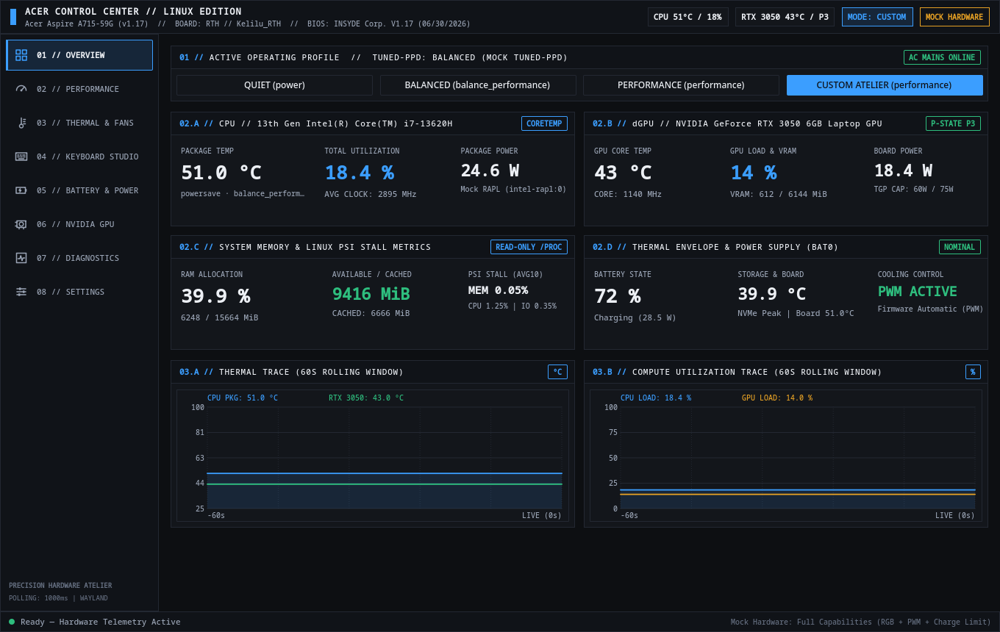 | 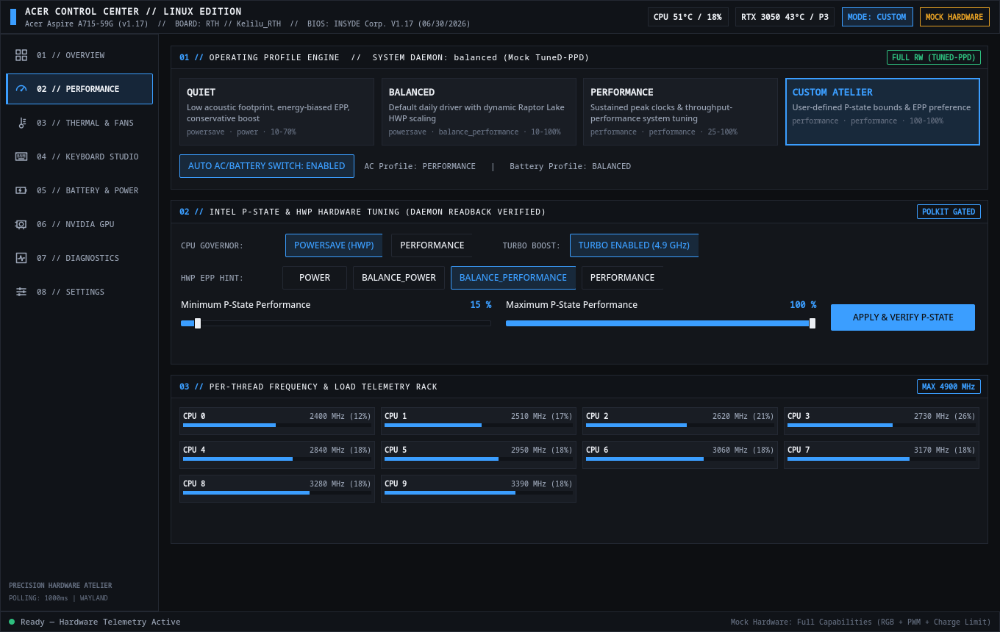 |

| 03 // Thermal & Fans | 04 // Keyboard Studio |
|---|---|
| 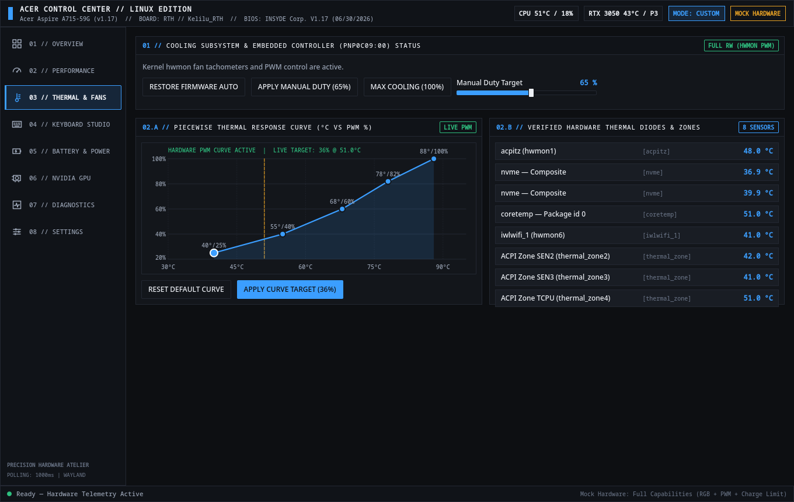 | 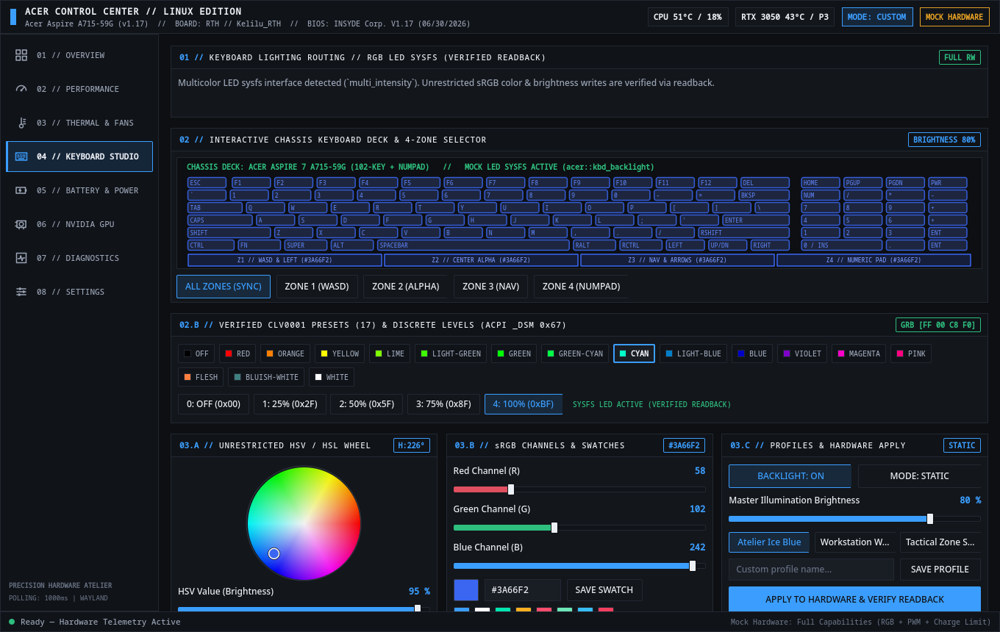 |

| 05 // Battery & Power | 06 // NVIDIA GPU |
|---|---|
| 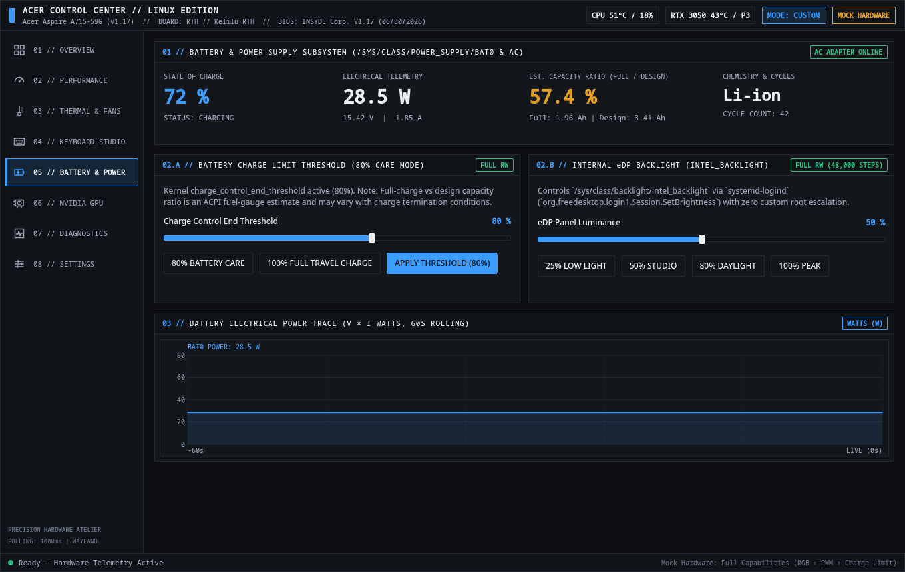 | 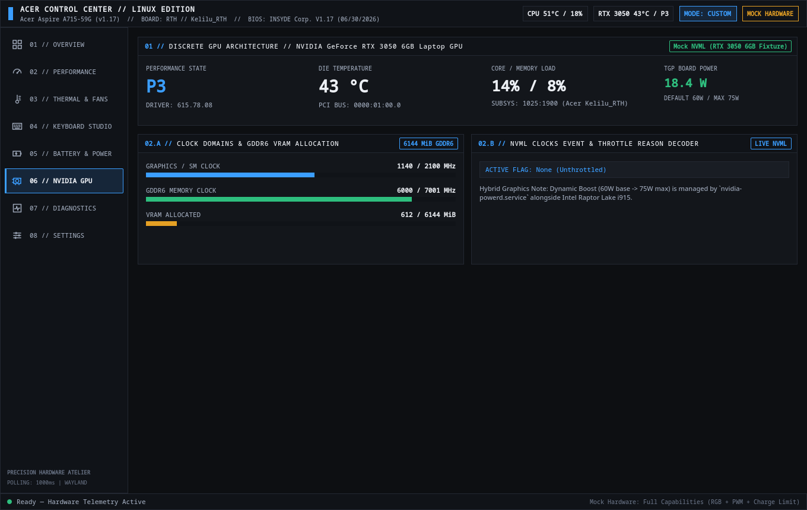 |

| 07 // Diagnostics | 08 // Settings |
|---|---|
| 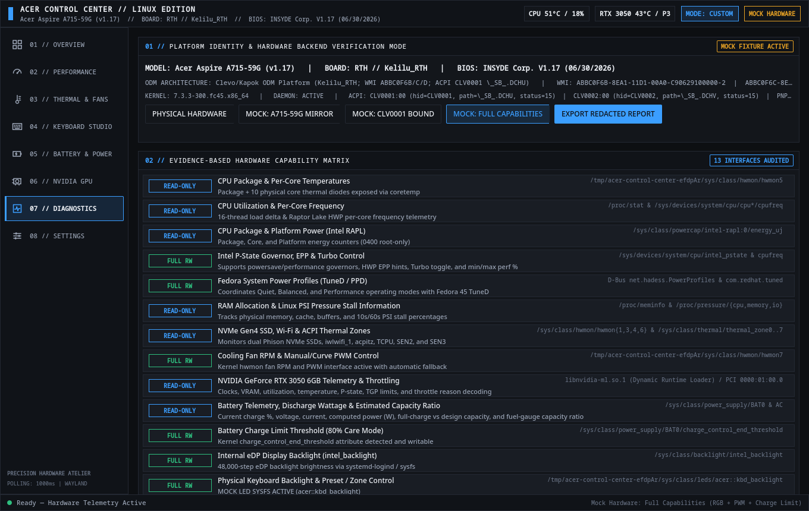 | 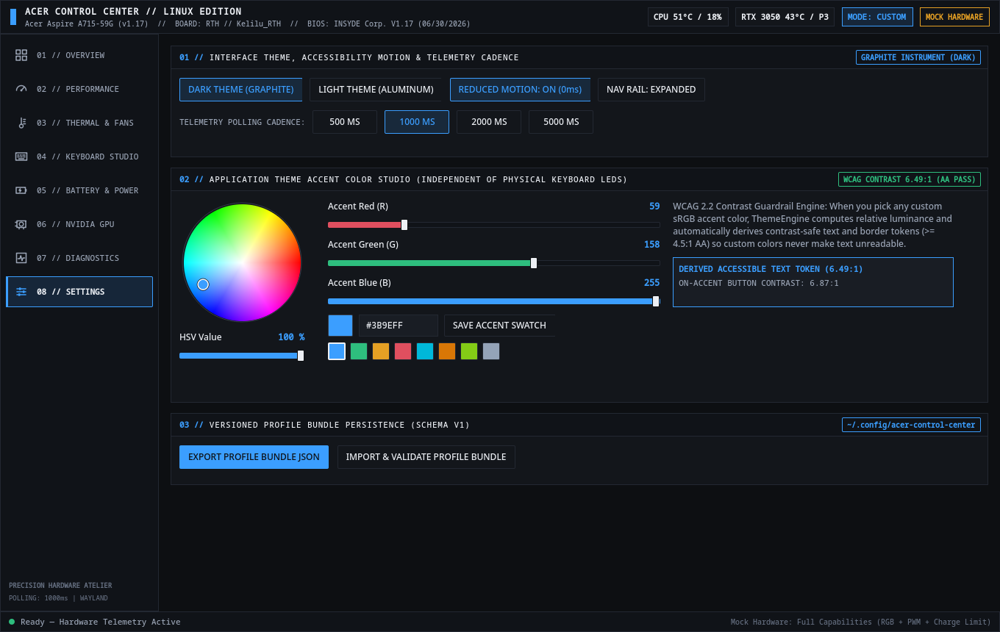 |

### Light Theme ("Anodized Aluminum") & Independent Color Systems
| Overview (Custom Emerald App Accent) | Keyboard Studio (Independent Keyboard RGB) | Settings (WCAG 2.1 AA Guardrail) |
|---|---|---|
| 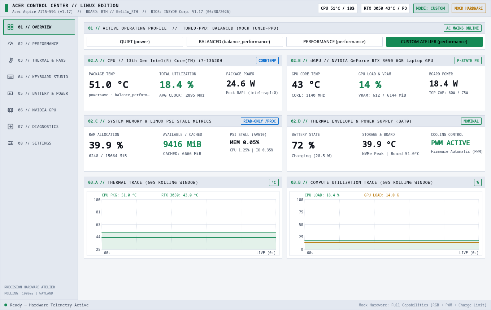 | 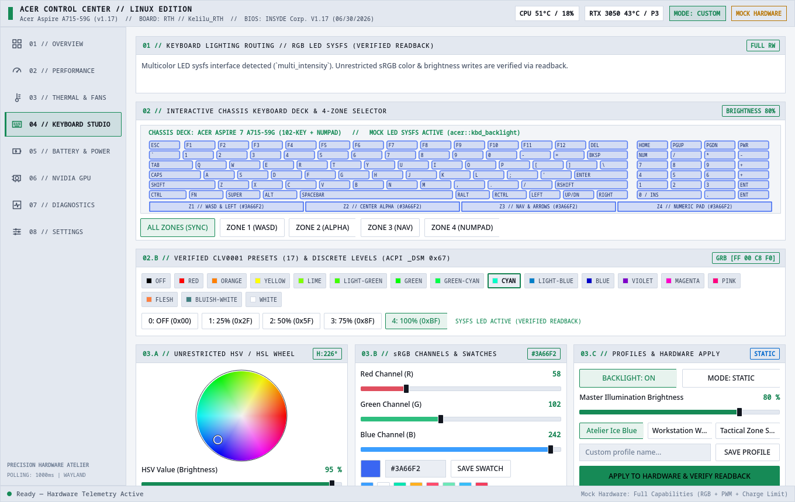 | 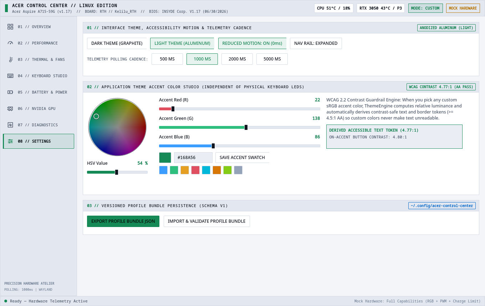 |

---

## Key Engineering Highlights

1. **Evidence-Based Hardware Honesty:**
   - Discovers DMI, WMI/ACPI topology, `hwmon`, `thermal_zone`, `intel_pstate`, `intel-rapl`, `BAT0`/`AC`, `intel_backlight`, TuneD/PPD and optional NVIDIA NVML (`libnvidia-ml.so.1`).
   - Capability states distinguish standard Linux interfaces from static firmware candidates, runtime queries, previews and physical verification.
   - The offline AML audit found vendor-specific Clevo/INSYDE fan and FlexiCharger paths. Those paths remain runtime-unverified; no fan or charge-limit firmware method is enabled by this public-main implementation.
2. **Strict Readback Verification & Safe Standard-Interface Controls:**
   - Implemented control adapters target documented Linux interfaces such as `intel_pstate`, TuneD/PPD, display backlight and optional standard LED/fan/battery sysfs nodes.
   - A standard node must be detected and validated before the corresponding control can be used. The A715-59G currently has no standard hwmon fan PWM or battery charge-threshold node.
3. **Independent Keyboard Lighting Preview and Application Theme Systems:**
   - **Keyboard Lighting Studio:** The optional clean-room CLV0001 backend provides 17 firmware presets and five brightness levels when loaded. Unrestricted colors may be used for UI preview, but are not represented as arbitrary physical RGB support. The interface distinguishes bound, unbound and preview states.
   - **Application Theme Accent Studio (`08 // SETTINGS`):** Unrestricted sRGB/HSV/Hex accent color engine with real-time WCAG 2.1 relative luminance and contrast ratio ($\ge 4.5:1$ AA) guardrail token derivation. Changing the physical keyboard color never alters the application theme accent, and vice versa.
4. **Optional Dynamic NVIDIA NVML Integration (`dlopen`) + `P8` Rail-Gate Spike Filter:**
   - Dynamically loads `libnvidia-ml.so.1` at runtime without compile-time hard linking; launches cleanly on Intel-only or Nouveau systems.
   - Detects and filters the `GA107BM` (`RTX 3050 Laptop GPU`) `P8` idle power rail-gating ADC artifact (`~312.23 W` bogus reading when power rails are gated), reporting `0.0 W (RAIL GATED P8)` while preserving raw sensor diagnostics.
5. **Least-Privilege Polkit & D-Bus Architecture:**
   - The GUI (`acer-control-center`) refuses to run as root (`geteuid() == 0` guard before `QApplication` initialization).
   - Privileged operations are isolated in `/usr/libexec/acer-control-daemon` (`io.github.zethasaintlab.AcerControlCenter1`) behind narrow Polkit actions and `Q_SCRIPTABLE` D-Bus slots with zero shell execution.

---

## Hardware Compatibility Matrix — Acer Aspire 7 A715-59G (`Kelilu_RTH`)

See [docs/HARDWARE_AUDIT_A715_59G.md](docs/HARDWARE_AUDIT_A715_59G.md) for the complete hardware reconnaissance report.

| Subsystem | Kernel / System Interface | Physical `A715-59G` Posture | Mock Fixture Support |
|---|---|---|---|
| **CPU Temperatures (Package + 10 Cores)** | `/sys/class/hwmon/hwmon5` (`coretemp`) | **Read-Only Supported** | Yes |
| **CPU Utilization & Per-Core Clocks** | `/proc/stat`, `cpufreq/scaling_cur_freq` | **Read-Only Supported** | Yes |
| **CPU Power (Intel RAPL)** | `/sys/class/powercap/intel-rapl:0/energy_uj` | **Read-Only via Daemon (`0400`)** | Yes |
| **Intel P-State Governor, EPP & Turbo** | `/sys/devices/system/cpu/intel_pstate` & `cpufreq` | **Fully Supported (Polkit + Readback)** | Yes |
| **System Power Profiles** | `net.hadess.PowerProfiles` (`tuned-ppd`) | **Fully Supported (D-Bus + Readback)** | Yes |
| **Memory & Linux PSI Pressure** | `/proc/meminfo`, `/proc/pressure/{cpu,memory,io}` | **Read-Only Supported** | Yes |
| **NVMe, Wi-Fi & ACPI Thermal Zones** | `hwmon1,3,4,6`, `thermal_zone0..7` (`SEN2`,`SEN3`,`TCPU`) | **Read-Only Supported** | Yes |
| **NVIDIA RTX 3050 6GB Telemetry** | `libnvidia-ml.so.1` (`dlopen` + `P8` filter) | **Read-Only Supported** | Yes |
| **Battery Telemetry & Est. Capacity Ratio** | `/sys/class/power_supply/BAT0` & `AC` | **Read-Only Supported** | Yes |
| **Internal eDP Panel Backlight** | `/sys/class/backlight/intel_backlight` (`logind`) | **Fully Supported (48,000 steps)** | Yes |
| **Fan Tachometer RPM & Manual PWM** | Standard hwmon fan/PWM ABI; vendor AML candidate paths | **No standard fan RPM/PWM node; static AML paths found but not runtime-verified** | **Mock support only** |
| **Keyboard Backlight & Firmware Presets** | `CLV0001` (`\_SB_.DCHU`, `_DSM 0x67`, clean-room `acer_clv0001_kbd`) or `/sys/class/leds/*kbd_backlight*` | **17 firmware presets + 5 brightness levels when driver is loaded; preview when unbound** | **Full RW in `clv0001` and `full` mock modes** |
| **Battery Charge Limit Threshold** | Standard power_supply threshold ABI; vendor FlexiCharger AML candidate | **No standard threshold node; static FlexiCharger path found but not runtime-verified** | **Mock support only** |

---

## Building, Testing & Running on Fedora Linux 45

### 1. Build & Run Automated Tests
```bash
cmake -B build -G Ninja -DCMAKE_BUILD_TYPE=Release
cmake --build build
ctest --test-dir build --output-on-failure
```

### 2. Launch the Desktop Application
```bash
# Launch against physical system hardware (read-verified):
./build/acer-control-center

# Launch with simulated CLV0001 kernel driver bound (17 presets & 5 discrete levels):
./build/acer-control-center --mock-hardware clv0001

# Launch with simulated full capabilities (RGB LED sysfs + Fan PWM + Battery Threshold):
./build/acer-control-center --mock-hardware full

# Launch with simulated A715-59G default kernel posture mirror (CLV0001 unbound):
./build/acer-control-center --mock-hardware mirror
```

### 3. Build Fedora 45 RPM Packages
See [docs/FEDORA_45_PACKAGING.md](docs/FEDORA_45_PACKAGING.md) for full details.
```bash
mkdir -p build/rpmbuild/{BUILD,BUILDROOT,RPMS,SOURCES,SPECS,SRPMS}
tar --exclude='./build' --exclude='./.git' \
    --transform='s,^\.,acer-control-center-1.0.0,' \
    -czf build/rpmbuild/SOURCES/acer-control-center-1.0.0.tar.gz .
cp packaging/fedora/acer-control-center.spec build/rpmbuild/SPECS/
rpmbuild --define "_topdir $(pwd)/build/rpmbuild" -ba build/rpmbuild/SPECS/acer-control-center.spec
```

---

## Project Documentation

- [Project State & Hydrogen Handoff](docs/PROJECT_STATE.md)
- [Engineering Workflow & Agent Collaboration](docs/WORKFLOW.md)
- [Industrial-Technical Design System](docs/DESIGN_SYSTEM.md)
- [Hardware Audit & Capability Matrix (`A715-59G / Kelilu_RTH`)](docs/HARDWARE_AUDIT_A715_59G.md)
## Project Documentation

- [Project State & Hydrogen Handoff](docs/PROJECT_STATE.md)
- [Engineering Workflow & Agent Collaboration](docs/WORKFLOW.md)
- [Industrial-Technical Design System](docs/DESIGN_SYSTEM.md)
- [Hardware Audit & Capability Matrix (`A715-59G / Kelilu_RTH`)](docs/HARDWARE_AUDIT_A715_59G.md)
- [Architecture Decision Records (ADR-001 & ADR-002)](docs/ARCHITECTURE_ADR.md)
- [Fedora Linux 45 Packaging & Privilege Guide](docs/FEDORA_45_PACKAGING.md)
- [Fedora Linux 45 Packaging & Privilege Guide](docs/FEDORA_45_PACKAGING.md)

---

## License

Copyright (C) 2026 zethasaintlab.  
Licensed under **GNU General Public License v3.0 or later** (`GPL-3.0-or-later`) with a Section 7 Additional Permission for optional runtime dynamic loading (`dlopen`) of `libnvidia-ml.so.1`. See [LICENSE](LICENSE) for full details.
