# Acer Control Center — Linux Edition

**A Precision Hardware Atelier for the Acer Aspire 7 A715-59G on Fedora Linux 45**

[](LICENSE)
[](docs/FEDORA_45_PACKAGING.md)
[-2EBE7E.svg)](docs/HARDWARE_AUDIT_A715_59G.md)

**Acer Control Center — Linux Edition** is a native C++23 and Qt 6.11 (`QtQuick` / Wayland) hardware management, telemetry, and personalization suite engineered for the **Acer Aspire 7 A715-59G** (`DMI: A715-59G`, `board_name: RTH`, `board_vendor: Kelilu_RTH`, BIOS `INSYDE Corp. V1.17`) running **Fedora Linux 45** under **KDE Plasma 6** and **Hyprland** (Wayland).

---

## Visual Tour — Precision Hardware Atelier

### Dark Theme ("Graphite Instrument" — Default)
| 01 // Overview | 02 // Performance |
|---|---|
| 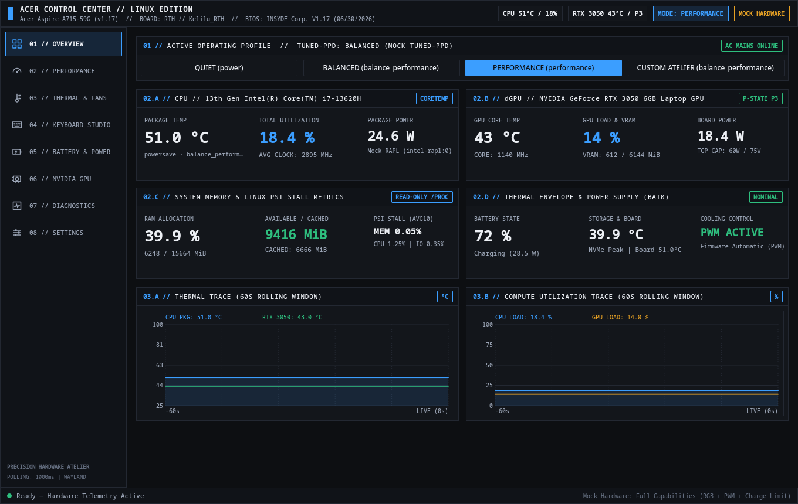 | 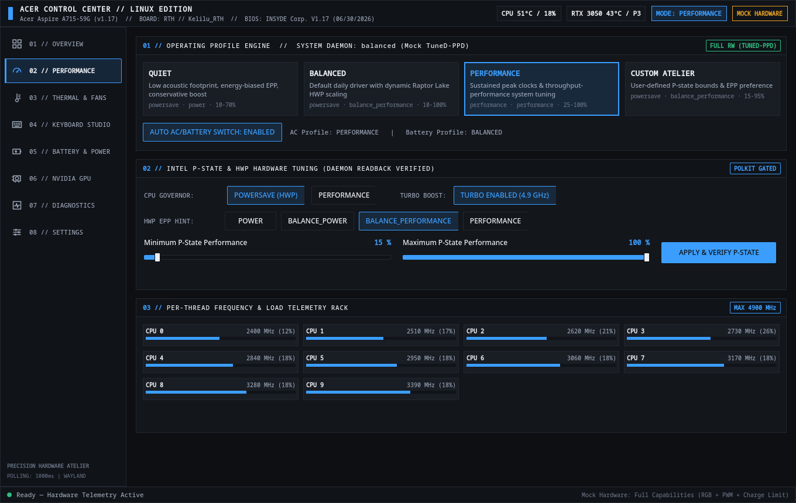 |

| 03 // Thermal & Fans | 04 // Keyboard Studio |
|---|---|
| 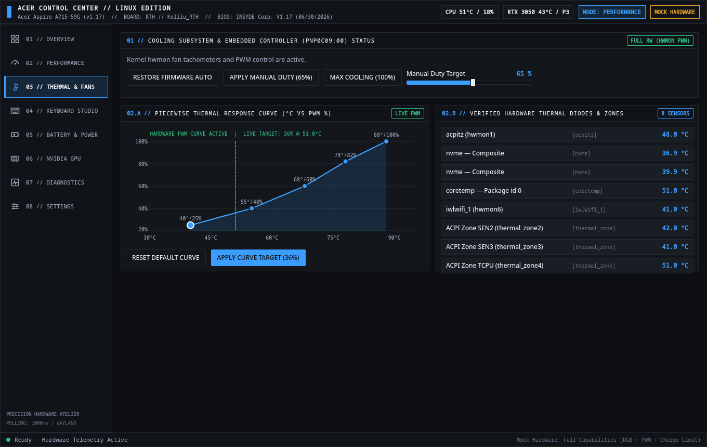 | 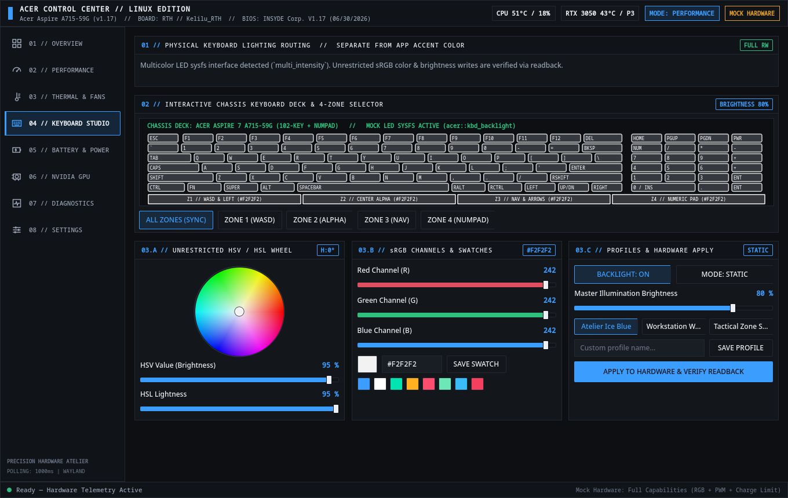 |

| 05 // Battery & Power | 06 // NVIDIA GPU |
|---|---|
| 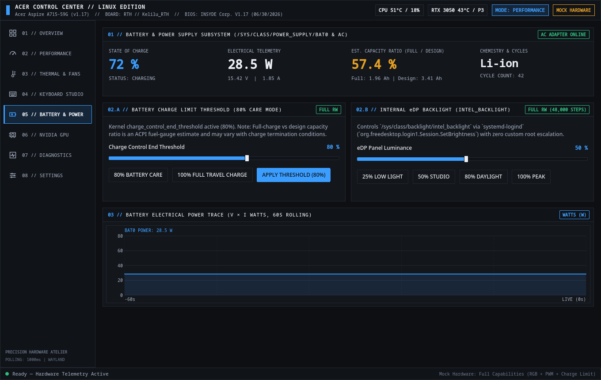 | 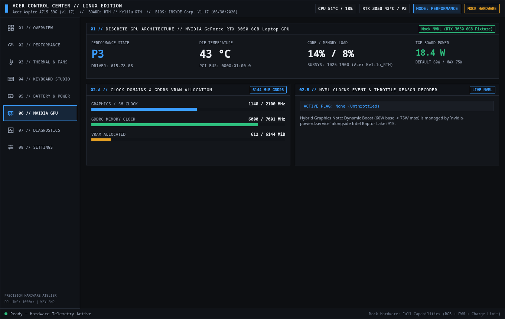 |

| 07 // Diagnostics | 08 // Settings |
|---|---|
| 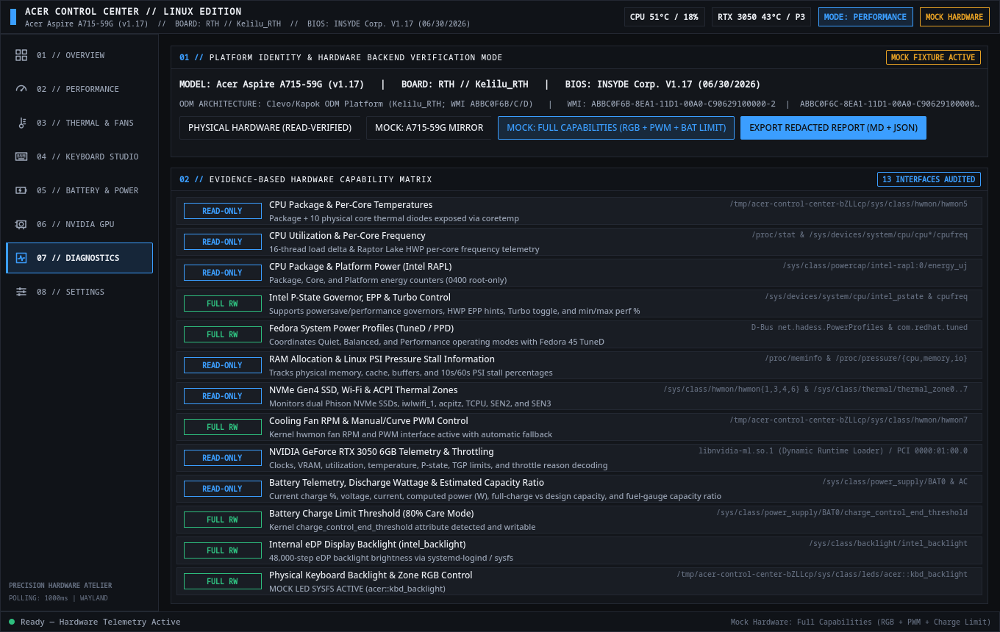 | 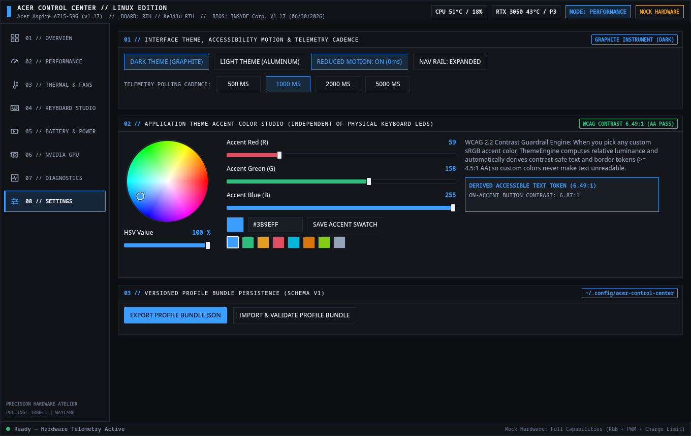 |

### Light Theme ("Anodized Aluminum") & Independent Color Systems
| Overview (Custom Emerald App Accent) | Keyboard Studio (Independent Keyboard RGB) | Settings (WCAG 2.1 AA Guardrail) |
|---|---|---|
| 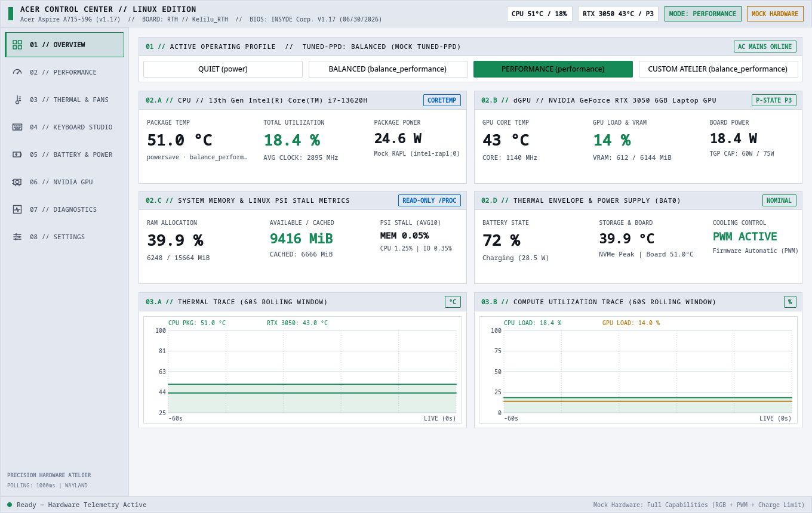 | 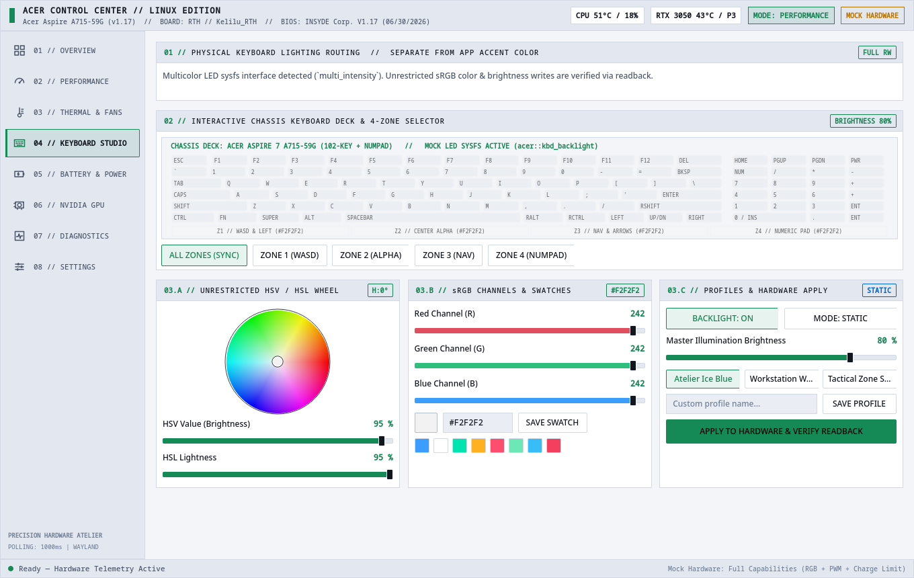 | 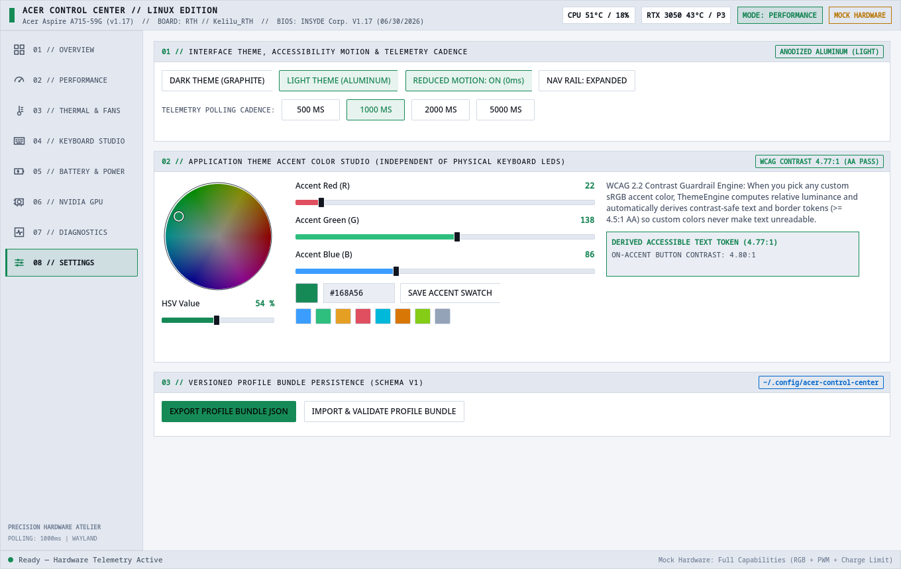 |

---

## Key Engineering Highlights

1. **Evidence-Based Hardware Honesty:**
   - Dynamically probes DMI, WMI GUIDs, `hwmon`, `thermal_zone`, `intel_pstate`, `intel-rapl`, `BAT0`/`AC`, `intel_backlight`, `tuned-ppd`, and NVIDIA NVML (`libnvidia-ml.so.1`).
   - Every capability is explicitly classified (`FULL RW`, `READ-ONLY`, `POLKIT GATED`, `NOT DETECTED`, `REQUIRES VERIFICATION`).
   - Zero undocumented Embedded Controller (`PNP0C09:00`) register writes, zero `/dev/mem` or `/dev/port` access, and zero arbitrary WMI method execution on the `Kelilu_RTH` Clevo/Kapok ODM board.
2. **Strict Readback Verification & Automatic Thermal Fallback:**
   - Every supported hardware write (`intel_pstate`, `tuned-ppd`, `intel_backlight`, and verified/mock `pwm1`, `leds`, `charge_control_end_threshold`) is verified via immediate sysfs/D-Bus readback before reporting success.
   - Any failure during CPU P-state or fan PWM writes rolls back to prior state or restores firmware automatic fan mode (`pwm1_enable = 2`).
3. **Two Independent Unrestricted Color Systems:**
   - **Physical Keyboard Lighting Studio (`04 // KEYBOARD STUDIO`):** Full 24-bit sRGB + HSV wheel + HSL lightness + Hex (`#RRGGBB`) + 4-zone chassis visualizer + custom swatches and named profiles.
   - **Application Theme Accent Studio (`08 // SETTINGS`):** Unrestricted sRGB/HSV/Hex accent color engine with real-time WCAG 2.1 relative luminance and contrast ratio ($\ge 4.5:1$ AA) guardrail token derivation. Changing the physical keyboard color never alters the application theme accent, and vice versa.
4. **Optional Dynamic NVIDIA NVML Integration (`dlopen`) + `P8` Rail-Gate Spike Filter:**
   - Dynamically loads `libnvidia-ml.so.1` at runtime without compile-time hard linking; launches cleanly on Intel-only or Nouveau systems.
   - Detects and filters the `GA107BM` (`RTX 3050 Laptop GPU`) `P8` idle power rail-gating ADC artifact (`~312.23 W` bogus reading when power rails are gated), reporting `0.0 W (RAIL GATED P8)` while preserving raw sensor diagnostics.
5. **Least-Privilege Polkit & D-Bus Architecture:**
   - The GUI (`acer-control-center`) refuses to run as root (`geteuid() == 0` guard before `QApplication` initialization).
   - Privileged operations are isolated in `/usr/libexec/acer-control-daemon` (`io.github.zethasaintlab.AcerControlCenter1`) behind narrow Polkit actions and `Q_SCRIPTABLE` D-Bus slots with zero shell execution.

---

## Hardware Compatibility Matrix — Acer Aspire 7 A715-59G (`Kelilu_RTH`)

See [docs/HARDWARE_AUDIT_A715_59G.md](docs/HARDWARE_AUDIT_A715_59G.md) for the complete hardware reconnaissance report.

| Subsystem | Kernel / System Interface | Physical `A715-59G` Posture | Mock Fixture Support |
|---|---|---|---|
| **CPU Temperatures (Package + 10 Cores)** | `/sys/class/hwmon/hwmon5` (`coretemp`) | **Read-Only Supported** | Yes |
| **CPU Utilization & Per-Core Clocks** | `/proc/stat`, `cpufreq/scaling_cur_freq` | **Read-Only Supported** | Yes |
| **CPU Power (Intel RAPL)** | `/sys/class/powercap/intel-rapl:0/energy_uj` | **Read-Only via Daemon (`0400`)** | Yes |
| **Intel P-State Governor, EPP & Turbo** | `/sys/devices/system/cpu/intel_pstate` & `cpufreq` | **Fully Supported (Polkit + Readback)** | Yes |
| **System Power Profiles** | `net.hadess.PowerProfiles` (`tuned-ppd`) | **Fully Supported (D-Bus + Readback)** | Yes |
| **Memory & Linux PSI Pressure** | `/proc/meminfo`, `/proc/pressure/{cpu,memory,io}` | **Read-Only Supported** | Yes |
| **NVMe, Wi-Fi & ACPI Thermal Zones** | `hwmon1,3,4,6`, `thermal_zone0..7` (`SEN2`,`SEN3`,`TCPU`) | **Read-Only Supported** | Yes |
| **NVIDIA RTX 3050 6GB Telemetry** | `libnvidia-ml.so.1` (`dlopen` + `P8` filter) | **Read-Only Supported** | Yes |
| **Battery Telemetry & Est. Capacity Ratio** | `/sys/class/power_supply/BAT0` & `AC` | **Read-Only Supported** | Yes |
| **Internal eDP Panel Backlight** | `/sys/class/backlight/intel_backlight` (`logind`) | **Fully Supported (48,000 steps)** | Yes |
| **Fan Tachometer RPM & Manual PWM** | `/sys/class/hwmon/*/fan*_input`, `pwm1` | **Not Exposed by Default Kernel (EC Auto)** | **Full RW in Mock Mode** |
| **Keyboard Backlight & RGB Zones** | `/sys/class/leds/*kbd_backlight*` | **Not Exposed by Default Kernel (Preview Mode)** | **Full RW in Mock Mode** |
| **Battery Charge Limit Threshold** | `BAT0/charge_control_end_threshold` | **Not Exposed by Default Kernel** | **Full RW in Mock Mode** |

---

## Building, Testing & Running on Fedora Linux 45

### 1. Build & Run Automated Tests
```bash
cmake -B build -G Ninja -DCMAKE_BUILD_TYPE=Release
cmake --build build
ctest --test-dir build --output-on-failure
```

### 2. Launch the Desktop Application
```bash
# Launch against physical system hardware (read-verified):
./build/acer-control-center

# Launch with simulated full capabilities (RGB LED sysfs + Fan PWM + Battery Threshold):
./build/acer-control-center --mock-hardware full

# Launch with simulated A715-59G default kernel posture mirror:
./build/acer-control-center --mock-hardware mirror
```

### 3. Build Fedora 45 RPM Packages
See [docs/FEDORA_45_PACKAGING.md](docs/FEDORA_45_PACKAGING.md) for full details.
```bash
mkdir -p build/rpmbuild/{BUILD,BUILDROOT,RPMS,SOURCES,SPECS,SRPMS}
tar --exclude='./build' --exclude='./.git' \
    --transform='s,^\.,acer-control-center-1.0.0,' \
    -czf build/rpmbuild/SOURCES/acer-control-center-1.0.0.tar.gz .
cp packaging/fedora/acer-control-center.spec build/rpmbuild/SPECS/
rpmbuild --define "_topdir $(pwd)/build/rpmbuild" -ba build/rpmbuild/SPECS/acer-control-center.spec
```

---

## Documentation Index

- [Hardware Audit & Capability Matrix (`A715-59G / Kelilu_RTH`)](docs/HARDWARE_AUDIT_A715_59G.md)
- [Architecture Decision Record (ADR-001)](docs/ARCHITECTURE_ADR.md)
- [Precision Hardware Atelier Design System](docs/DESIGN_SYSTEM.md)
- [Fedora Linux 45 Packaging & Privilege Guide](docs/FEDORA_45_PACKAGING.md)

---

## License

Copyright (C) 2026 zethasaintlab.  
Licensed under **GNU General Public License v3.0 or later** (`GPL-3.0-or-later`) with a Section 7 Additional Permission for optional runtime dynamic loading (`dlopen`) of `libnvidia-ml.so.1`. See [LICENSE](LICENSE) for full details.
